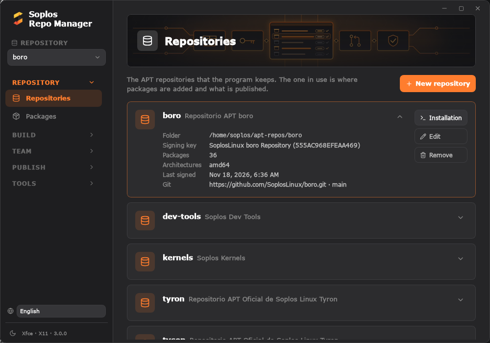
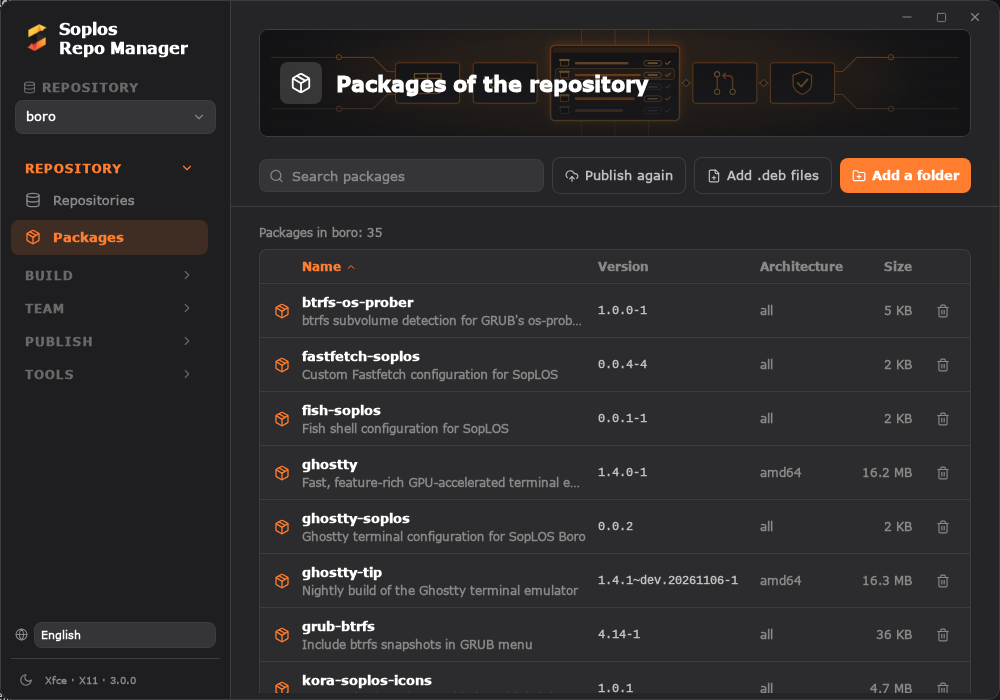
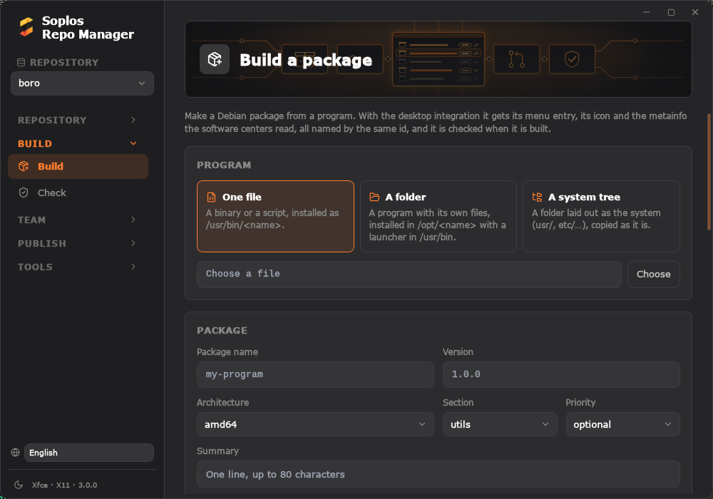
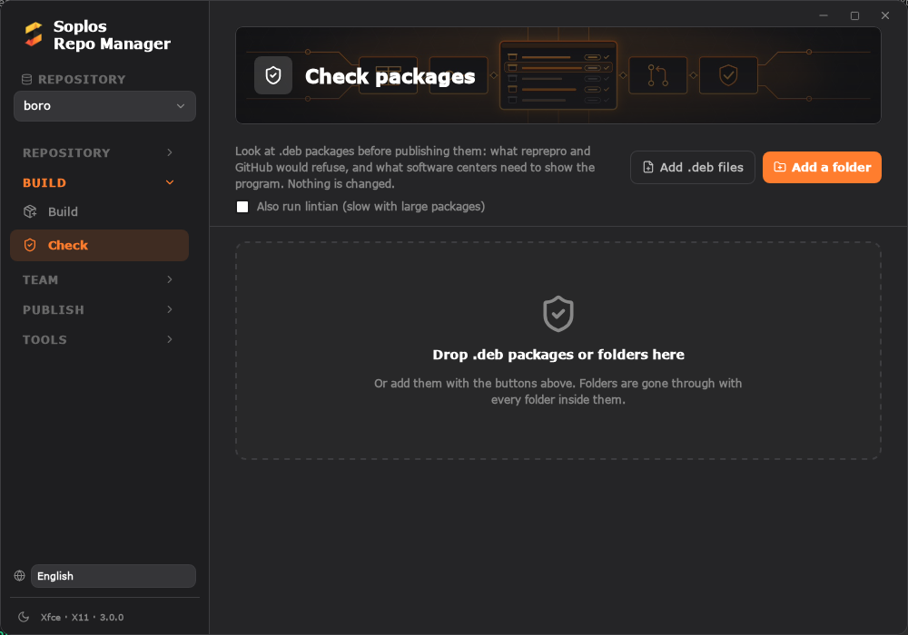
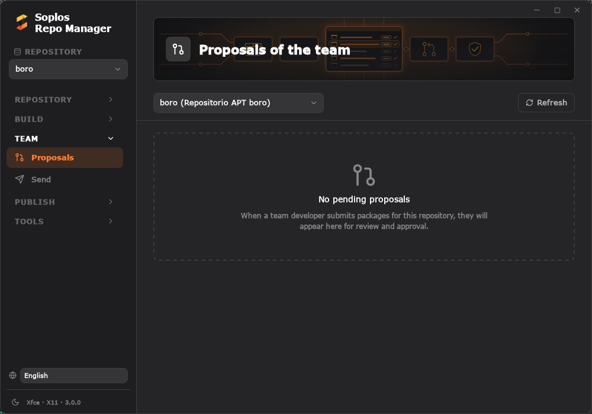
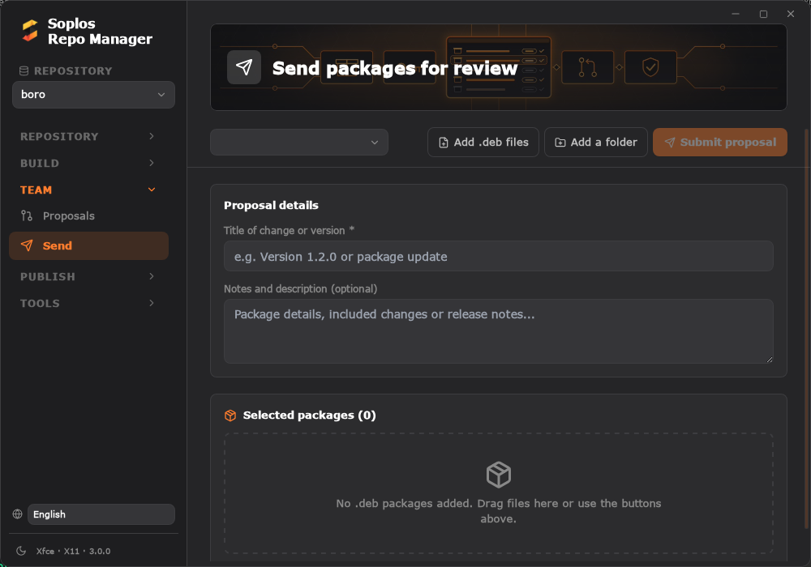
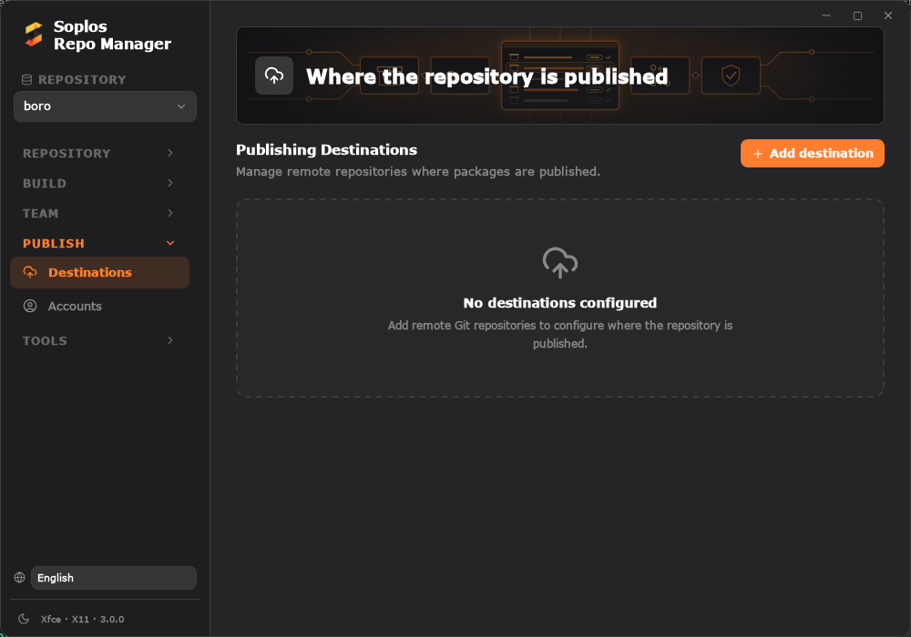
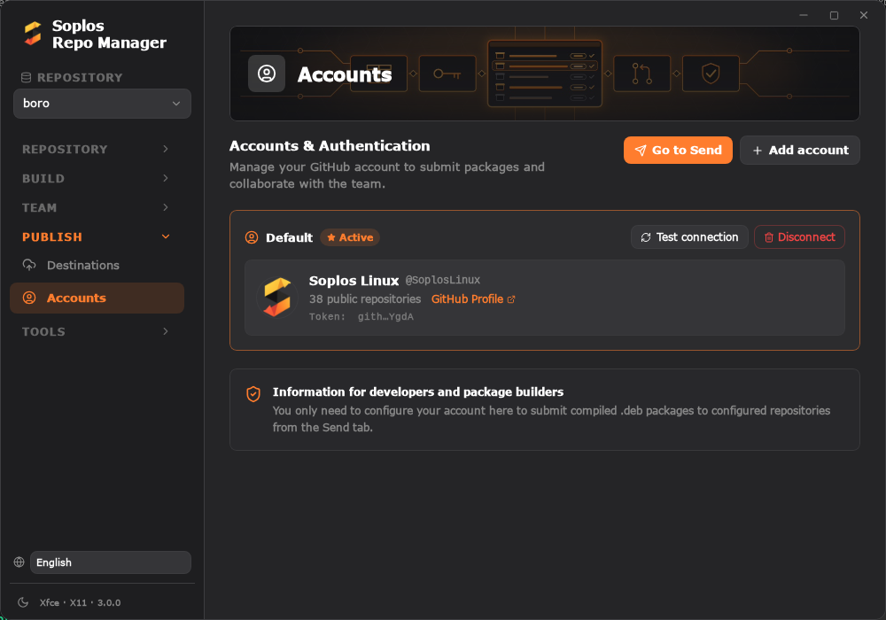
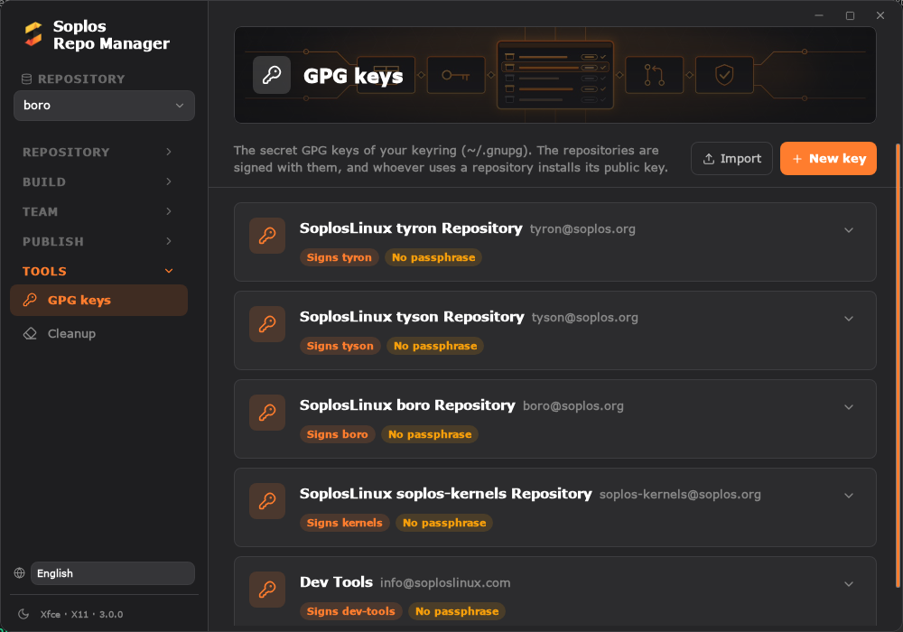
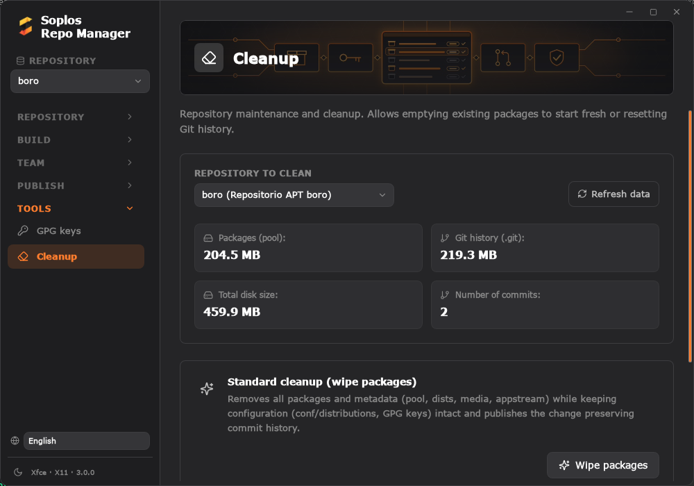

# Soplos Repo Manager 3.0


Builds Debian packages, checks them and publishes them in APT repositories signed with GPG and published on GitHub.

Version 3.0 joins two programs of Soplos Linux, both written in Python 3 with GTK3: Soplos Repo Manager, which kept the APT repositories, and Soplos Packager, which built the Debian packages. It is a rewrite with Tauri 2: a Rust backend and a Svelte 4 and Tailwind CSS interface. It is meant for any APT repository, not only the ones of Soplos Linux.

The program has two roles. The administrator of a repository builds, checks and publishes its packages, and receives the packages a team sends for review. A member of the team builds and checks packages and sends them to the administrator, who accepts or rejects them.

## Screenshots

| | |
|:---:|:---:|
|  **Repositories**: each one with its signing key, its packages and where it is published |  **Packages** of a repository |
|  **Review** before adding: new, upgraded or already there |  **Build** a package from a program, with its desktop integration |
|  **Check** packages before they are published |  **Proposals** the team sends, to accept or reject |
|  **Send** packages for review |  **Destinations** proposals are sent to |
|  **GPG keys** that sign the repositories |  **Cleanup** of a repository |

## Pages

| Group | Page | What it does |
|-------|------|--------------|
| Repository | Repositories | Makes a repository in an empty folder (reprepro, signing key, title, Git address), edits it, and writes the `.sources` file and the install script that users run to add it |
| | Packages | Lists the packages; adds files or whole folders, gone through with every folder inside, to one or several repositories at once, after a review (new, upgrade, same, older, duplicate, wrong architecture, no Section or Priority); removes packages |
| Build | Build | A package from one program (`/usr/bin`), from a program in a folder (`/opt` with a launcher in `/usr/bin`) or from a folder laid out as the system, with the menu entry, the icon in every size of the hicolor theme and the AppStream metainfo, all named by the same application id |
| | Check | What reprepro and GitHub would refuse and what software centers need to show the program; lintian on request |
| Team | Proposals | The pull requests a team sends: accepted (added, signed and published, optionally emptying the repository first) or rejected with a reason |
| | Send | Sends packages to a repository as a pull request |
| Publish | Destinations | The repositories proposals are sent to |
| | Accounts | GitHub accounts, with their token in the keyring of the system |
| Tools | GPG keys | Makes, imports, exports and backs up the keys that sign the repositories |
| | Cleanup | Empties the packages of a repository, or also resets its Git history to a single commit |

## How a repository is published

Adding packages is one step: `reprepro includedeb` for each package, one `reprepro export`, the AppStream data (DEP-11) made from the metainfo, icons and screenshots of the packages themselves, the `Release` signed once (`Release.gpg` and `InRelease`), and one Git commit pushed to the branch of the repository. The history of the repository is kept; only the Cleanup page rewrites it, when it is asked to.

Long jobs show their progress and the output of git, reprepro and gpg in a bar at the bottom of the window, and can be cancelled.

## Security

- GitHub tokens are kept only in the keyring of the system, through the Secret Service (GNOME Keyring, KWallet, KeePassXC). With no keyring, an account cannot be added and the page explains how to install one.
- A token never goes on a command line, into a URL or into the `.git/config` of a repository: git gets it as an HTTP header through its environment, and curl reads it from its standard input. The remote URLs with a token that the 2.x version wrote are cleaned the next time the repository is published.
- The window never runs as root.

## Keyboard shortcuts

| Shortcut | Action |
|---|---|
| F1 | About |
| Ctrl+1 to Ctrl+9 | The first nine pages |
| Ctrl+Tab, Ctrl+Shift+Tab | Next or previous page |
| Ctrl+Q | Quit |

## Documentation

A manual page is installed with the package:

```bash
man soplos-repo-manager
```

## Languages

English, Spanish, German, French, Italian, Portuguese, Romanian and Russian. It starts in the system language and falls back to English.

## Development

```bash
npm install
npm run tauri dev
```

The development server uses port 1434.

## License

Copyright © 2026 Sergi Perich <info@soploslinux.com>. Published under the GPL-3.0-or-later license. See `LICENSE`.
